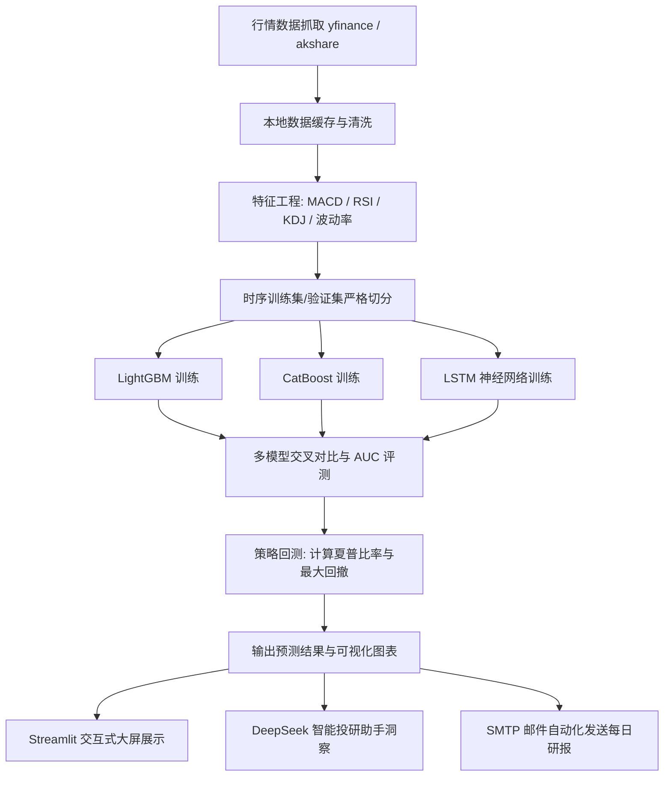

<div align="center">

# 📈 MicroQuant (资金量化与智能投研系统)

<p align="center">
  <strong>基于多机器学习/深度学习集成预测与大语言模型协同的智能化量化交易投研平台</strong><br>
  <em>Multi-Model Quantitative Trading, Backtesting & AI Financial Investment Research Platform powered by LightGBM, CatBoost, LSTM & LLMs</em>
</p>

[](LICENSE)
[](https://www.python.org/)
[](https://streamlit.io/)
[](https://lightgbm.readthedocs.io/)
[](https://catboost.ai/)
[](https://www.tensorflow.org/)
[](https://siliconflow.cn/)
[](https://github.com/KissFeng/micro-quant/pulls)

**简体中文** | [English](./README_EN.md)

</div>

---

## 📑 目录

- [💡 为什么选择 MicroQuant？](#-为什么选择-microquant)
- [✨ 核心特性矩阵与功能全景](#-核心特性矩阵与功能全景)
  - [1. 多源行情数据获取与本地智能缓存](#1-多源行情数据获取与本地智能缓存)
  - [2. 高维金融量化特征工程体系](#2-高维金融量化特征工程体系)
  - [3. 异构模型竞技场 (LightGBM vs CatBoost vs LSTM)](#3-异构模型竞技场-lightgbm-vs-catboost-vs-lstm)
  - [4. 全仿真事件驱动回测引擎与绩效度量](#4-全仿真事件驱动回测引擎与绩效度量)
  - [5. Streamlit 多页面交互式投研大屏](#5-streamlit-多页面交互式投研大屏)
  - [6. DeepSeek AI 智能投研助手与自动化研报推送](#6-deepseek-ai-智能投研助手与自动化研报推送)
- [🏗️ 系统全景架构与数据流](#️-系统全景架构与数据流)
- [🔄 投研决策生命周期](#-投研决策生命周期)
- [🛠️ 技术栈清单](#️-技术栈清单)
- [🚀 快速启动指南](#-快速启动指南)
  - [1. 环境准备与虚拟环境](#1-环境准备与虚拟环境)
  - [2. 依赖安装](#2-依赖安装)
  - [3. 配置环境变量](#3-配置环境变量)
  - [4. 运行全流程流水线](#4-运行全流程流水线)
  - [5. 启动 Streamlit 交互式 Web 大屏](#5-启动-streamlit-交互式-web-大屏)
- [⚙️ 环境变量配置参考](#️-环境变量配置参考)
- [📁 目录结构概览](#-目录结构概览)
- [⚠️ 免责声明与风险提示](#️-免责声明与风险提示)
- [🤝 参与贡献](#-参与贡献)
- [📄 开源协议](#-开源协议)

---

## 💡 为什么选择 MicroQuant？

在个人量化交易和日常投研过程中，传统仅依赖单一技术指标（如单纯金叉死叉）或单体脚本的量化方案，通常面临特征维度单一、缺乏横向模型对比、无回测滑点摩擦以及缺少直观交互界面的瓶颈：

| 维度 | 传统量化脚本 / 基础指标 | 📈 MicroQuant 智能化投研方案 |
| :--- | :--- | :--- |
| **预测模型** | 单一线性回归或固定规则死判 | **GBDT 梯度提升与时序深度学习融合**（LightGBM + CatBoost + LSTM）并行竞技 |
| **特征广度** | 仅依赖 5/10/20 日普通移动均线 | **动量、波动率、资金流、技术震荡因子等 20+ 高维特征** 矩阵提炼 |
| **策略回测** | 忽略手续费和滑点的理想化算分 | **扣除佣金（千分之一）与滑点摩擦** 的真实动态资产净值与最大回撤核算 |
| **投研交互** | 纯命令行终端输出，图表分散在本地文件夹 | **现代化 Streamlit 交互式三栏大屏**，K线联动、指标对比实时渲染 |
| **大模型赋能**| 纯数据堆叠，缺乏决策解释与深度研报 | **DeepSeek 驱动的 AI 投研助手**，精准归因多模型分歧并生成调仓建议 |

---

## ✨ 核心特性矩阵与功能全景

### 1. 多源行情数据获取与本地智能缓存
* **多源稳定数据适配**：支持 yfinance、akshare 等权威行情源获取 A 股核心自选池历史日线数据；
* **时效缓存优化机制**：内置多级本地数据缓存机制（默认 3 天有效期），有效降低网络请求开销与频控风险。

### 2. 高维金融量化特征工程体系
* **技术指标矩阵**：自动计算 MACD、RSI、KDJ、布林带（Bollinger Bands）、ATR（真实波幅）等衍生因子；
* **价量与动量衍生因子**：长短期收益率差分、成交量均线比（Volume Ratio）、换手波动率；
* **特征标准化与防前视偏差**：严格采用滑动时间窗口时序切分，杜绝未来信息穿越（Data Leakage）。

### 3. 异构模型竞技场 (LightGBM vs CatBoost vs LSTM)
* **LightGBM**：基于直方图优化的极速梯度提升树，捕捉非线性多因子交互；
* **CatBoost**：对称树结构与抗过拟合设计，对不同市场风格下的泛化能力极强；
* **LSTM (长短期记忆网络)**：基于深度学习建模长周期时序记忆与趋势形态依赖；
* **多模型交叉胜率评估**：同台测试准确率 (Accuracy)、AUC、胜率、盈亏比等核心指标。

### 4. 全仿真事件驱动回测引擎与绩效度量
* **真实交易摩擦仿真**：支持自定义初始本金（如 10 万元）、交易佣金率（千分之一）与滑点损耗；
* **专业级绩效度量体系**：
  * **累计年化收益率** (Cumulative Return)
  * **夏普比率** (Sharpe Ratio)
  * **历史最大回撤** (Max Drawdown)
  * **交易胜率与盈亏比** (Win Rate & Profit/Loss Ratio)

### 5. Streamlit 多页面交互式投研大屏
* **预测大屏 (`1_📊_预测结果.py`)**：按自选股矩阵呈现各模型多空概率分布、置信度阈值过滤；
* **AI 投研助手 (`2_🤖_AI助手.py`)**：基于 LLM 对当前预测结果进行多轮对话解读，支持一键生成投资组合调仓策略；
* **个股深度画像 (`3_📈_股票详情.py`)**：结合 Plotly 交互式 K 线图与历史因子贡献分解。

### 6. DeepSeek AI 智能投研助手与自动化研报推送
* **硅基流动 (SiliconFlow) 接入**：无缝驱动 DeepSeek-V3.2 推理引擎进行投研归因分析；
* **摘要模式优化**：支持长上下文切片压缩，大幅降低 API Token 消耗；
* **SMTP 研报自动推送**：支持将每日收盘后预测分析报告与回测图表一键推送到指定的电子邮箱。

---

## 🏗️ 系统全景架构与数据流

```text
┌────────────────────────────────────────────────────────────────────────┐
│                   Web 交互层 (Streamlit 多页面响应式仪表盘)             │
│  - 综合预测大屏 (Plotly K线)   - AI 投资顾问助手 (流式对话与组合推荐)    │
│  - 个股多维深度剖析页         - 参数动态调节与阈值敏感度控制面板       │
└───────────────────────────────────┬────────────────────────────────────┘
                                    │
┌───────────────────────────────────▼────────────────────────────────────┐
│                       核心服务与业务逻辑层                            │
│  - LLMService (基于 SiliconFlow 的 DeepSeek 语义理解与投研建议萃取)    │
│  - PredictionService (多模型融合打分、置信度过滤与多空信号生成)        │
│  - ChartService (专业金融量化图表与绩效曲线绘制)                       │
└───────────────────┬───────────────────────────────┬────────────────────┘
                    │                               │
┌───────────────────▼──────────────┐   ┌────────────▼────────────────────┐
│      算法模型竞技场 (Models)      │   │       回测与评估引擎            │
│  - LightGBM 极速决策树分类器     │   │  - BacktestEngine 仿真撮合撮成  │
│  - CatBoost 对称抗噪决策树       │   │  - 手续费、滑点摩擦损耗扣减     │
│  - LSTM 深度时序序列记忆神经网络 │   │  - 夏普比率 / 最大回撤 / 胜率   │
└───────────────────┬──────────────┘   └─────────────────────────────────┘
                    │
┌───────────────────▼────────────────────────────────────────────────────┐
│                    数据工程与特征加工流水线                            │
│  - DataLoader: 权威行情源采集 (yfinance / akshare) 与本地三日缓存      │
│  - FeatureEngineering: 20+ 动量、震荡、波动率金融因子矩阵加工与标准化 │
└────────────────────────────────────────────────────────────────────────┘
```

---

## 🔄 投研决策生命周期



---

## 🛠️ 技术栈清单

| 领域 | 核心技术选型 | 说明 |
| :--- | :--- | :--- |
| **基础语言** | **Python 3.10+** | 科学计算与量化金融首选语言环境 |
| **Web 仪表盘**| **Streamlit + Plotly** | 现代化交互式数据大屏，毫秒级图表响应 |
| **数据科学** | **Pandas + NumPy + Scipy** | 高性能时序向量化数据处理与矩阵运算 |
| **行情数据** | **yfinance / akshare** | 覆盖 A 股多行业核心龙头标的历史日线数据 |
| **机器学习** | **LightGBM + CatBoost** | 高效且抗过拟合的梯度提升树算法 |
| **深度学习** | **TensorFlow / Keras** | 基于 LSTM 架构的时序深度表征学习 |
| **大语言模型**| **DeepSeek-V3.2 (SiliconFlow)** | 高性价比大模型，用于因子解释与组合推荐 |
| **图表与邮件**| **Matplotlib + Seaborn + smtplib** | 静态回测图表生成与 HTML 富文本研报邮件发送 |

---

## 🚀 快速启动指南

### 1. 环境准备与虚拟环境
推荐使用 Python 3.10 或 3.11 环境：

```bash
# 1. 克隆项目仓库
git clone https://github.com/KissFeng/micro-quant.git
cd micro-quant

# 2. 创建并激活虚拟环境
python3 -m venv .venv
source .venv/bin/activate  # Windows 用户运行: .venv\Scripts\activate
```

---

### 2. 依赖安装

```bash
pip install --upgrade pip
pip install -r requirements.txt
```

---

### 3. 配置环境变量

从示例模板复制并初始化 `.env` 配置文件：

```bash
cp .env.example .env
```

编辑 `.env` 文件，填入你的配置（如使用 AI 助手功能，需填写硅基流动 API Key）：

```env
# 硅基流动 API 配置（用于 AI 智能助手与调仓建议）
SILICONFLOW_API_KEY=sk-xxxxxx
SILICONFLOW_MODEL=deepseek-ai/DeepSeek-V3.2

# 邮箱报告推送配置（可选）
EMAIL_SENDER=your_email@qq.com
EMAIL_PASSWORD=your_smtp_authorization_code
EMAIL_RECIPIENT=recipient@example.com
SMTP_SERVER=smtp.qq.com
SMTP_PORT=465
```

---

### 4. 运行全流程流水线

你可以通过主入口一键完成“数据获取 -> 特征加工 -> 模型训练 -> 预测 -> 回测评估”：

```bash
# 执行完整投研流水线
python main.py
```

* 预测结果与回测评估图表将自动保存在 `output/` 目录下（如 `predictions.csv`、`model_comparison.png` 等）。

---

### 5. 启动 Streamlit 交互式 Web 大屏

```bash
streamlit run app.py
```

终端将输出本地访问地址（通常为 [http://localhost:8501](http://localhost:8501)），在浏览器中打开即可体验：
* 📊 **多模型预测与置信度雷达**
* 🤖 **AI 投研顾问多轮深度对话**
* 📈 **自选股全生命周期走势复盘**

---

## ⚙️ 环境变量配置参考

在 `.env` 中支持如下环境变量设定：

| 配置项 | 默认参考值 | 是否必填 | 作用说明 |
| :--- | :--- | :---: | :--- |
| `SILICONFLOW_API_KEY` | - | 是 (使用AI时) | 硅基流动平台 API 密钥 |
| `SILICONFLOW_MODEL` | `deepseek-ai/DeepSeek-V3.2` | 否 | 指定调用的大语言模型版本 |
| `EMAIL_SENDER` | - | 否 | 发件人邮箱账号 |
| `EMAIL_PASSWORD` | - | 否 | 邮箱 SMTP 服务授权码 |
| `EMAIL_RECIPIENT` | - | 否 | 报告接收人邮箱 |
| `SMTP_SERVER` | `smtp.qq.com` | 否 | 邮件服务主机地址 |
| `SMTP_PORT` | `465` | 否 | SSL 邮件服务端口 |

---

## 📁 目录结构概览

```text
.
├── config.py                 # 全局参数、自选股列表与超参数定义
├── data_loader.py            # 多源行情数据拉取与本地缓存机制
├── feature_engineering.py     # 20+ 金融衍生技术因子特征工程
├── models/                   # 核心量化算法模型库
│   ├── lgbm_model.py         # LightGBM 极速决策树模型
│   ├── catboost_model.py     # CatBoost 对称决策树模型
│   └── lstm_model.py         # LSTM 循环神经网络时序模型
├── backtest.py               # 事件驱动全仿真策略回测引擎
├── evaluator.py              # 多模型交叉验证与横向评估体系
├── visualizer.py             # 收益曲线与因子对比可视化工具
├── email_sender.py           # 自动化 HTML 研报邮件发送模块
├── train.py                  # 离线模型批量训练入口
├── predict.py                # 针对自选股的未来周期预测入口
├── main.py                   # 综合自动化分析总入口
├── app.py                    # Streamlit Web 应用统一主入口
├── pages/                    # Streamlit 多子页面控制台
│   ├── 1_📊_预测结果.py       # 预测看板与胜率雷达
│   ├── 2_🤖_AI助手.py         # AI 投资顾问与组合调仓对话
│   └── 3_📈_股票详情.py       # 个股技术形态与深度复盘
├── services/                 # 前后端解耦服务层 (LLM / Prediction / Chart)
├── utils/                    # 上下文拼接与会话管理辅助工具
├── requirements.txt          # Python 项目依赖清单
├── .env.example              # 环境变量配置模板
├── .gitignore                # Git 忽略配置
├── LICENSE                   # 开源授权协议
└── README.md                 # 项目主说明文档
```

---

## ⚠️ 免责声明与风险提示

1. **非投资建议声明**：本项目及其包含的代码、模型预测、AI 生成结论仅作为**量化技术研究、学术探讨与机器学习算法工程实践**用途，**不构成任何形式的投资建议、交易指导或收益承诺**；
2. **市场风险提示**：金融市场具备极高不确定性，历史行情回测表现绝不代表未来实际收益；
3. **独立决策原则**：投资者应基于自身独立风险承受能力作出判断，因使用本项目代码进行真实交易产生的一切盈亏与风险，开发者团队不承担任何责任。

---

## 🤝 参与贡献

欢迎对 MicroQuant 提交 Issue 与 Pull Request！

1. Fork 本项目并新建分支（例如：`feature/transformer-model`）；
2. 保持代码规范，遵循 PEP 8 标准并添加必要的注释；
3. 发起 Pull Request 并清晰阐述改动背景与实验对比指标。

---

## 📄 开源协议

本项目采用 [MIT License](LICENSE) 授权许可。
